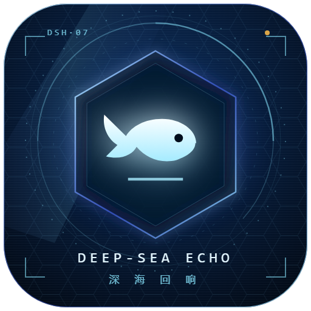
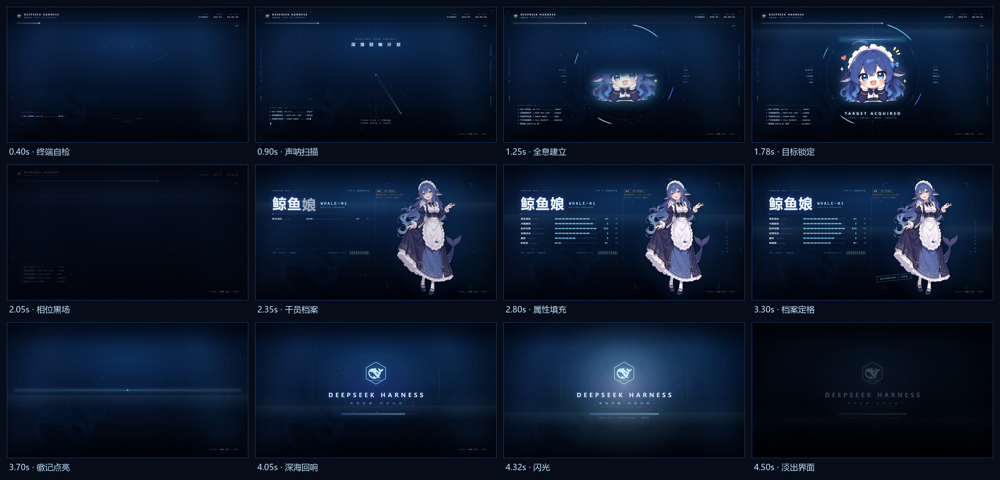

# dsh-deepsea-echo · 深海回响启动动画

给 [DeepSeek Harness](https://github.com/deepseek-ai/deepseek-harness) Web 界面加一段约 **4.6 秒**的
明日方舟风格全屏启动动画：PRTS 终端自检 → 声呐扫描 → 全息锁定 → 干员档案 → 深海回响定格。
深蓝工业 HUD、鲸鱼娘全息登录与干员档案，播放结束自动淡出进入界面。

> 每次打开或刷新 DSH Web 页面时自动播放；**点击任意位置 / 按 Esc 立即跳过**；
> 设置 →「启动动画」里可以关掉、改时长（3.6s / 4.6s / 5.0s）、**单独开关启动音效**、立即重播。





## 分镜 / Storyboard

| 时间 | 画面 | 音效 |
| --- | --- | --- |
| 0.0 – 2.0s | **PRTS 终端自检**：深蓝终端 HUD、逐字启动日志、「深海回响计划」标题、声呐扫描环 + 雷达扫描线 | 深海低频底噪、终端滴答、声呐 ping |
| 1.0 – 2.1s | **全息锁定**：目标环展开，Q 版鲸鱼娘以扫描线遮罩 + RGB 分离逐段显现，`TARGET ACQUIRED` | 上扬噪声扫频、电子碎响 |
| 2.0 – 3.6s | **干员档案**：切镜黑场 → 绝密标签、`鲸鱼娘 / WHALE-01`、六项属性条填满、`AUTHORIZED` 印章、全身立绘滑入 + 光扫 | 低频撞击、打字细响、印章「啪」 |
| 3.6 – 4.4s | **深海回响定格**：扫描光刃炸开、鲸鱼徽记描边点亮、`DEEPSEEK HARNESS` 字标与「深海回响 · 启动完成」 | 上升 riser → 重低音 + 钟声泛音 |
| 4.4 – 4.6s | 白光闪一下，遮罩淡出，露出下面的 DSH 界面 | 尾音淡出 |

配色：深海军蓝底（`#01040c → #0a2a52`）+ DSH 蓝光效（`#4d6bfe`）+ 冰青高光（`#8be8ff`），
切角面板 / 等宽字 / 细线刻度 / 菱形装饰，尽量贴近明日方舟的界面语言。

完整动效录屏（70 帧）：[`preview/startup-animation.webp`](preview/startup-animation.webp)
可交互预览：[`preview/index.html`](preview/index.html)（`?t=2500` 可定格在 2.5s）

## 音效（4 套原创配乐，可切换 / 可关闭）

启动音效是**代码合成的原创配乐**（[`scripts/make-sfx.py`](scripts/make-sfx.py)，无采样、无版权素材），
共 **4 套风格 + 关闭**，与分镜时间轴严格对齐：

| 预设 | 风格 |
| --- | --- |
| **深海回响**（默认） | 明日方舟 PV 感的电子管弦：D 小调 138 BPM，暗色 pad、工业鼓组、八分音符贝斯、braam drop、合唱尾音 |
| **凛冬管弦** | 弦乐 ostinato + 定音鼓 + 铜管 stab + 合唱，压迫感更强的纯管弦编制 |
| **霓虹脉冲** | 150 BPM 工业电子：四拍底鼓、锯齿贝斯 16 分、滤波琶音、glitch 碎响、sub drop |
| **静海氛围** | 没有鼓：暖 pad + 钢琴钟声 + 声呐 ping + 柔和收尾，适合安静的启动 |
| **关闭** | 完全静音 |

设置 →「启动动画」→「启动音效」里用按钮**五选一**（含关闭），与动画总开关互相独立。
浏览器自动播放策略可能拦下第一次发声；被拦时保持静音、不会报错，点击一次界面后自动恢复。

## 安装

```sh
# 在 DSH 命令行里
dsh plugin --profile web add https://github.com/cshengyi023-collab/dsh-deepsea-echo
```

插件包含预构建的 `lib/client.js`，安装后**不需要额外的构建步骤或构建脚本授权**。

## 使用

- **播放**：打开或刷新 DSH 页面时自动全屏播放一次；
- **跳过**：播放中点击任意位置，或按 `Esc`；
- **设置**：设置 →「启动动画」→ 启用开关 / 播放时长 / 启动音效开关 / 重播动画；
- **偏好存储**：`localStorage["dsh-deepsea-echo:v1"]`（会从旧的 `dsh-whale-startup:v1` 自动迁移）。

## 卸载

```sh
dsh plugin --profile web remove dsh-deepsea-echo
```

## 实现

- 纯 **client 插件**（`dsh.client.platform = "web"`）：host 半边只有一个空的 `apply()`，
  让包在 profile 里有 Loader entry；浏览器半边由 DSH 的 client module system 以
  `/plugins/dsh-deepsea-echo/client.js` 提供给页面。
- `lib/client.js` 是**手写的 lazy-CJS bundle**（`window.__ModuleLoader__.load({ id, factory })`），
  立绘、颗粒贴图与音效都以 data URI 内嵌，离线可用、无第三方依赖。
- 插件 `apply()` 时立刻把全屏遮罩挂到 `document.documentElement` 上（早于 shell 首帧），
  播放完或插件被禁用时移除全部 DOM、样式、音频与事件监听；另有看门狗兜底，渲染出错也不会卡住界面。
- 动画是一条由 `requestAnimationFrame` 驱动的可寻址时间轴（`render(t)`，基准 4600ms）：
  DOM 变换、Canvas 粒子、遮罩、逐字文本都在同一帧函数里计算；时长选项只是对时间轴整体缩放
  （音效随之时长等比变速）。
- 设置页注册在 `settings.section` 插槽（id `deepsea-echo`）。

## 开发

```sh
# 重新生成 lib/client.js（把 assets/ 里的立绘与音效内嵌进 bundle）
node scripts/build.mjs

# 重新合成 4 套启动配乐（纯 Python，无第三方音频库）
python scripts/make-sfx.py

# 本地预览（浏览器打开，自动播放；?t=2500 定格在 2.5s）
open preview/index.html

# 用无头 Chrome 逐帧截图，重建 preview/startup-animation.webp 与 storyboard.png
chrome --headless=new --window-size=960,540 \
  --screenshot=frame.png "file:///<repo>/preview/index.html?t=2500"
python scripts/make-preview-assets.py <frames-dir>
```

## 目录

```
lib/index.js              host 半边（空 apply）
lib/client.js             浏览器半边（构建产物，内嵌立绘/贴图/音效）
src/client.template.js    动画源码（模板，含 __ASSET_*__ 占位）
cordis.patch.yml          bundle patch：把插件插进 profile
assets/                   角色立绘、插件图标（icon-source.svg → plugin-icon.png）、市场截图、音效
preview/                  动效预览、关键帧、可交互预览页
scripts/                  构建 / 音效 / 图标 / 预览素材脚本
```

## 许可

- **代码、音效、图标**：MIT（见 [`LICENSE`](LICENSE)）。音效由仓库脚本合成，图标由
  `assets/icon-source.svg` 绘制渲染，均无第三方素材。
- **角色美术**：**不适用 MIT**，按 **CC BY-NC-SA 4.0** 随仓库非商业分发，署名链为
  上善（角色原案）→ ZipZipPipe（女仆装再设计）→ Small-tailqwq（本仓库所用素材版本）。
  详见 [`NOTICE-ARTWORK.md`](NOTICE-ARTWORK.md) 与 [`LICENSE-ARTWORK.md`](LICENSE-ARTWORK.md)。
  商业使用请替换为你有权使用的立绘。

## English

A startup animation for the DeepSeek Harness Web GUI, Arknights-flavoured: a PRTS terminal boot,
sonar scan, hologram lock-on and an operator file that end in a deep-sea lockup (about 4.6 s),
followed by a fade into the UI. It plays full-screen on every page load, can be skipped with a
click or `Esc`, and can be switched off, re-timed (3.6s / 4.6s / 5.0s), muted with its own
independent sound toggle, or replayed from **Settings → 启动动画** (Startup Animation).
A synthesized sound design follows the same timeline. Implemented as a client-only DSH plugin
with a hand-written lazy-CJS bundle and embedded artwork/audio — no build step and no runtime
dependencies. Code, sound and icon are MIT; the character artwork is CC BY-NC-SA 4.0
(see `NOTICE-ARTWORK.md`).
